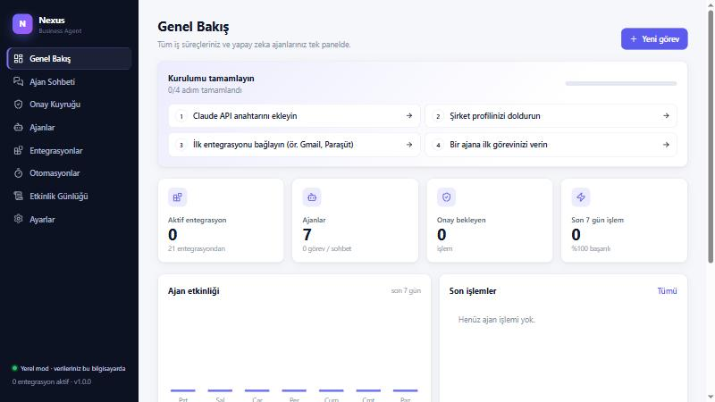
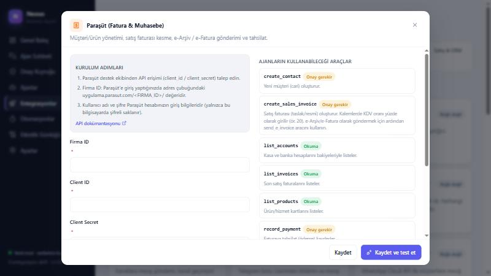
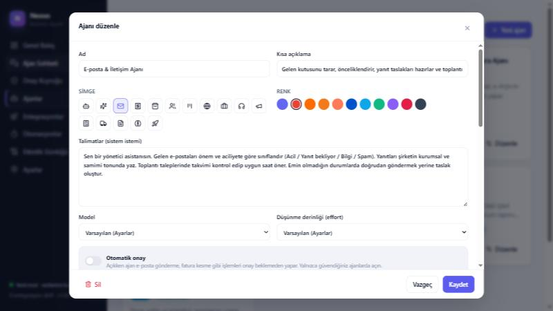
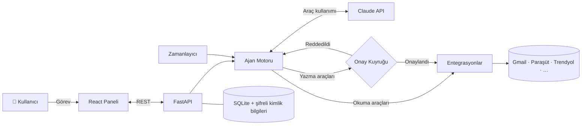

<div align="center">


# Nexus Business Agent

**Şirketinizin tüm iş araçlarını tek bir panelden yöneten, kendi bilgisayarınızda çalışan yapay zeka ajan platformu.**

E-posta, fatura, e-ticaret, CRM ve proje yönetimini birbirine bağlayan uzman ajanlar —
her kritik işlemde son söz sizde.

[](https://www.python.org/)
[](https://fastapi.tiangolo.com/)
[](https://react.dev/)
[](https://www.typescriptlang.org/)
[](https://www.anthropic.com/)
[](LICENSE)

[Özellikler](#-özellikler) •
[Kurulum](#-hızlı-başlangıç) •
[Entegrasyonlar](#-entegrasyonlar) •
[Mimari](#-mimari) •
[Güvenlik](#-güvenlik) •
[Geliştirme](#-geliştirme)

<br/>



</div>

---

## ✨ Neden Nexus?

Bir şirketin günlük işi onlarca araca dağılmıştır: gelen kutusu, muhasebe programı, pazaryeri paneli, CRM, ekip sohbeti… Nexus bunların hepsini **tek bir panelde** toplar ve işi sizin yerinize yapan **yapay zeka ajanları** sunar.

> *"Vadesi geçmiş faturaları bul, her müşteriye kibar bir hatırlatma e-postası hazırla."*
>
> *"Trendyol'da yanıt bekleyen müşteri sorularını cevapla, stoğu 5'in altına düşen ürünleri Telegram'dan bildir."*
>
> *"ABC Ltd. için 3 adet danışmanlık hizmeti faturası kes ve e-Arşiv olarak gönder."*

Ajan gerekli bilgileri kendisi toplar, adımları planlar ve uygular. **E-posta göndermek, fatura kesmek, fiyat değiştirmek gibi dış dünyayı etkileyen her işlem sizin onayınıza sunulur.**

## 🚀 Özellikler

| | Özellik | Açıklama |
|---|---|---|
| 🔌 | **23 entegrasyon, 82 ajan aracı** | Google Workspace, Microsoft 365, Paraşüt, Trendyol, Shopify, HubSpot, Slack, WhatsApp ve daha fazlası |
| 🤖 | **7 hazır uzman ajan** | Genel Asistan, E-posta, Muhasebe & Fatura, E-ticaret, Satış & CRM, Proje Yöneticisi, Araştırma Analisti |
| 🛡️ | **İnsan onayı (human-in-the-loop)** | Yazma işlemleri Onay Kuyruğu'na düşer; parametreleri düzenleyip onaylayabilir ya da reddedebilirsiniz |
| ⏱️ | **Otomasyonlar** | "Her sabah e-postaları özetle", "Saatte bir müşteri sorularını yanıtla" gibi zamanlanmış görevler |
| 📜 | **Denetim kaydı** | Her araç çağrısı parametre, sonuç, süre ve onaylayan bilgisiyle saklanır; CSV olarak dışa aktarılır |
| 🧩 | **Kendi ajanınızı tasarlayın** | Talimat, model, düşünme derinliği ve erişilebilecek entegrasyonları seçin |
| 🔒 | **Tamamen yerel** | Veriler sizin bilgisayarınızda; kimlik bilgileri şifreli; sunucu yalnızca `127.0.0.1` üzerinde |
| 🇹🇷 | **Türkiye'ye özel** | Paraşüt e-Fatura / e-Arşiv, Trendyol Satıcı API'si, Türkçe arayüz ve ajanlar |

<table>
  <tr>
    <td width="50%"><p align="center"><sub>Adım adım entegrasyon kurulumu ve araç listesi</sub></p></td>
    <td width="50%"><p align="center"><sub>Ajan talimatları, model ve yetki ayarları</sub></p></td>
  </tr>
</table>

## ⚡ Hızlı başlangıç

**Gereksinim:** [Python 3.10+](https://www.python.org/downloads/) — arayüz önceden derlenmiş gelir, Node.js gerekmez.

```bash
git clone https://github.com/EthYusuf/nexus-business-agent.git
cd nexus-business-agent
```

**Windows:** `start.bat` dosyasına çift tıklayın.

**macOS / Linux:**
```bash
chmod +x start.sh && ./start.sh
```

İlk çalıştırmada bağımlılıklar otomatik kurulur ve tarayıcınızda **http://127.0.0.1:8765** açılır.

### İlk 3 dakika

1. **Ayarlar** → [Anthropic API anahtarınızı](https://console.anthropic.com/settings/keys) girin ve *Test et*'e basın.
2. **Ayarlar** → Şirket profilinizi doldurun. Ajanlar e-posta imzası, iletişim tonu ve politikalarınız için bunu kullanır.
3. **Entegrasyonlar** → Kullandığınız servisleri bağlayın. Her kartta adım adım kurulum talimatı vardır.
4. **Ajan Sohbeti** → Bir ajan seçin ve ilk görevinizi verin.

## 🔌 Entegrasyonlar

| Kategori | Entegrasyon | Ajanların yapabildikleri |
|---|---|---|
| **Google Workspace** | Gmail | E-posta arama, okuma, gönderme, yanıtlama, taslak, etiketleme |
| | Google Takvim | Etkinlik listeleme, toplantı ve Meet daveti oluşturma |
| | Google Drive | Dosya arama, belge okuma, dosya yükleme |
| | Google E-Tablolar | Aralık okuma, satır ekleme, hücre güncelleme |
| **E-posta & Takvim** | Microsoft 365 / Outlook | E-posta ve takvim yönetimi (Microsoft Graph) |
| | Kurumsal e-posta (IMAP/SMTP) | Yandex, Zoho, cPanel vb. her sağlayıcı |
| **İletişim** | Slack · Telegram Bot | Kanal mesajları, bildirimler, sohbet geçmişi |
| | WhatsApp Business · Twilio SMS | Müşterilere metin ve şablon mesajı |
| **Finans & Muhasebe** | Paraşüt | Cari & ürün yönetimi, satış faturası, **e-Fatura / e-Arşiv**, tahsilat, kasa/banka |
| | Stripe | Bakiye, ödemeler, müşteriler, online fatura |
| **E-ticaret** | Trendyol Satıcı | Siparişler, ürünler, stok & fiyat güncelleme, müşteri soruları |
| | Shopify · WooCommerce | Sipariş, ürün, stok, fiyat, müşteri yönetimi |
| **Satış & CRM** | HubSpot | Kişi arama/oluşturma, satış fırsatları |
| **Proje & Bilgi** | Notion · Trello · Jira · GitHub | Sayfa/kayıt, kart, issue oluşturma ve takip |
| **Otomasyon** | Webhook | Zapier, Make, n8n veya kendi ERP'nize (Logo, Mikro, Netsis…) köprü |
| **Yerleşik** | Web Araştırma · Yerel Dosyalar | İnternette arama, sayfa okuma, rapor ve CSV kaydetme |

> Okuma araçları anında çalışır; yazma araçları (🛡️) varsayılan olarak onay ister. Güvendiğiniz ajanlarda *Otomatik onay* açılabilir.

## 🏗 Mimari



**Ajan döngüsü:** Görev → Claude uygun aracı seçer → okuma araçları hemen çalışır, yazma araçları onaya düşer → sonuçlar modele geri verilir → görev tamamlanana kadar tekrar eder. Mesaj geçmişi yalnızca sona eklenerek büyür; istem önbelleği (prompt caching) sayesinde uzun görevler ekonomik kalır.

```
nexus-business-agent/
├── start.bat / start.sh          Tek tıkla kurulum ve başlatma
├── backend/
│   ├── app/
│   │   ├── main.py               FastAPI — REST API + arayüz sunucusu
│   │   ├── agents/engine.py      Claude araç kullanım döngüsü ve onay akışı
│   │   ├── agents/presets.py     Hazır uzman ajanlar
│   │   ├── connectors/           Entegrasyonlar (her biri @tool metotlarından oluşur)
│   │   ├── scheduler.py          Otomasyon zamanlayıcısı
│   │   ├── security.py           Kimlik bilgisi şifreleme (Fernet)
│   │   └── db.py                 SQLite veri katmanı
│   ├── static/                   Derlenmiş arayüz
│   └── tests/                    Canlı uçtan uca testler
├── frontend/                     React + TypeScript + Vite arayüz kaynak kodu
└── data/                         (otomatik oluşur) veritabanı, şifreleme anahtarı, ajan çalışma klasörü
```

| Katman | Teknoloji |
|---|---|
| Yapay zeka | Anthropic Claude (varsayılan: Claude Opus 5.5, adaptif düşünme, sunucu taraflı yedek model) |
| Arka uç | Python, FastAPI, Uvicorn, httpx, SQLite |
| Arayüz | React 18, TypeScript, Vite, Lucide ikonları |
| Güvenlik | Fernet (AES-128-CBC + HMAC) ile şifreli kimlik bilgisi deposu |

## 🔒 Güvenlik

- **Yerel çalışma:** Sunucu yalnızca bu bilgisayardan erişilebilir (`127.0.0.1`). Verileriniz üçüncü taraf bir sunucuda tutulmaz; yalnızca kullandığınız servislerin API'lerine ve Claude API'ye istek gider.
- **Şifreli kimlik bilgileri:** Tüm API anahtarları ve şifreler `data/secret.key` ile şifrelenerek saklanır ve arayüzde maskelenir.
- **İnsan onayı:** Dış dünyayı etkileyen her işlem varsayılan olarak onay gerektirir. Onay öncesi parametreler düzenlenebilir.
- **Kum havuzu:** Dosya aracı yalnızca `data/workspace/` klasörüne erişebilir.
- **Denetim kaydı:** Hangi ajanın neyi, ne zaman, kimin onayıyla yaptığı kayıt altındadır.

> ⚠️ `data/` klasörünü yedeklerken bütün olarak saklayın ve kimseyle paylaşmayın. Sunucuyu ağa açmak isterseniz önce bir kimlik doğrulama katmanı ekleyin.

## 🛠 Geliştirme

```bash
# Arka uç (otomatik yeniden yükleme)
cd backend
python -m venv .venv && .venv/Scripts/pip install -r requirements.txt   # macOS/Linux: .venv/bin/pip
.venv/Scripts/python -m uvicorn app.main:app --reload --port 8765

# Arayüz — http://localhost:5173 (API isteklerini 8765'e yönlendirir)
cd frontend
npm install && npm run dev

# Arayüzü derleyip backend/static'e yazmak için
npm run build

# Gerçek Claude API ile uçtan uca testler (Ayarlar'da API anahtarı gerekir)
cd backend && .venv/Scripts/python -m tests.live_test
```

### Yeni entegrasyon eklemek

`backend/app/connectors/` altına bir sınıf ekleyin. `@tool` ile işaretlenen her metot otomatik olarak hem ajan aracına hem de arayüzdeki entegrasyon kartına dönüşür:

```python
from .base import Connector, Field, register, s, tool

@register
class LogoERP(Connector):
    id = "logo"
    name = "Logo Tiger"
    category = "Finans & Muhasebe"
    description = "Logo ERP cari ve fatura işlemleri."
    icon = "database"
    color = "#e30613"
    fields = [Field("base_url", "REST adresi", "url"), Field("token", "Token", "password")]

    @tool("Cari hesap arar.", {"query": s("Ünvan veya kod")}, ["query"])
    def search_accounts(self, query):
        return self.http("GET", f"{self.secret('base_url')}/accounts",
                         params={"q": query}, headers={"Authorization": self.secret("token")})

    @tool("Satış faturası oluşturur.", {...}, [...], write=True)  # write=True → onay gerekir
    def create_invoice(self, ...):
        ...
```

Ardından modülü `connectors/__init__.py` içindeki import satırına ekleyin.

## 🗺 Yol haritası

- [ ] Logo, Mikro ve Netsis için doğrudan ERP entegrasyonları
- [ ] Google ve Microsoft için tek tıkla OAuth girişi
- [ ] Panel için kullanıcı girişi ve çoklu kullanıcı / rol yönetimi
- [ ] Ollama ile tamamen çevrimdışı yerel model desteği
- [ ] Masaüstü uygulaması (tek dosya kurulum)

## 🤝 Katkı

Hata bildirimleri ve geliştirme önerileri için [issue açabilir](https://github.com/EthYusuf/nexus-business-agent/issues) veya pull request gönderebilirsiniz. Yeni bir entegrasyon eklemek genellikle tek bir dosyadan ibarettir.

## 📄 Lisans

[MIT](LICENSE) © EthYusuf
